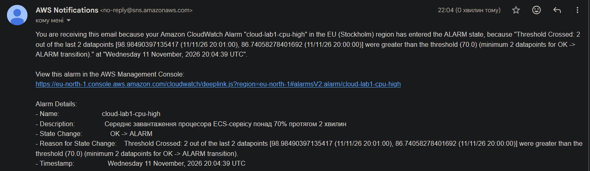
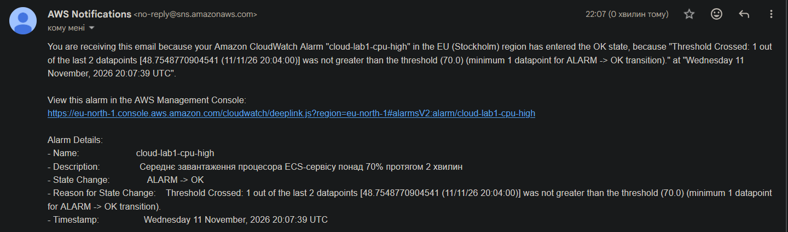

# Сповіщення

Код: [`terraform/alerts.tf`](../terraform/alerts.tf). Адреса отримувача задається змінною `alert_email` у `terraform.tfvars`, який не потрапляє в репозиторій.

## Умова

**Середнє завантаження процесора ECS-сервісу понад 70 % протягом 2 хвилин поспіль.**

| Параметр `aws_cloudwatch_metric_alarm.cpu_high` | Значення | Зміст |
|---|---|---|
| `namespace` / `metric_name` | `AWS/ECS` / `CPUUtilization` | метрика сервісу |
| `statistic` | `Average` | середнє по всіх екземплярах |
| `period` | 60 | одна точка = одна хвилина |
| `evaluation_periods` / `datapoints_to_alarm` | 2 / 2 | обидві останні точки мають перевищити поріг |
| `threshold` | 70 | поріг, % |
| `treat_missing_data` | `notBreaching` | відсутність даних не вважається проблемою |
| `alarm_actions` | тема SNS | лист при переході в стан ALARM |
| `ok_actions` | тема SNS | лист при поверненні в стан OK |

Канал доставки: тема `aws_sns_topic.alerts` і підписка `aws_sns_topic_subscription.email` з протоколом `email`. Після `terraform apply` підписку треба один раз підтвердити з листа.

### Обґрунтування

- **Поріг 70 % вищий за ціль масштабування (60 %).** Якщо масштабування справляється, процесор тримається біля 60 % і лист не надходить. Лист означає, що навантаження росте швидше, ніж додаються екземпляри, або що досягнуто максимуму.
- **«Протягом 2 хвилин», а не миттєво.** Короткий сплеск (розгортання нової версії, один важкий запит) не має будити людину. Без цієї вимоги стан перемикався б туди-сюди на кожному коливанні метрики біля порогу (flapping), і отримувач швидко перестав би читати такі листи.
- **Чому процесор, а не латентність.** Для цього сервісу процесор є причиною повільних відповідей, і ця метрика вже використовується для масштабування, тож поведінку легко пояснити. З погляду користувача корисніше сповіщення на латентність p95: воно спрацьовує на будь-яку причину повільності (база, мережа, кеш), а не тільки на процесор. У реальному сервісі варто мати обидва: латентність як основне, процесор як підказку про причину.

## Результат під час навантажувального тесту

Прогін «без кешу» з [`LOADTEST.md`](LOADTEST.md), 11.11.2026. Журнал станів (`aws cloudwatch describe-alarm-history`):

| Подія | Час (UTC) | За київським часом |
|---|---|---|
| Початок тесту | 19:57:35 | 21:57:35 |
| Початок сталого навантаження | 20:00:35 | 22:00:35 |
| OK → ALARM, перший лист | 20:04:39 | 22:04:39 |
| ALARM → OK, другий лист | 20:07:39 | 22:07:39 |

**Лист 1 — надмірне навантаження:**

**Лист 2 — повернення до норми:**

Обидва листи надійшли в ту саму хвилину, коли змінився стан.

## Час реакції

**Від початку сталого навантаження (20:00:35) до першого листа (20:04:39) — 4 хв 04 с.** Від початку першої хвилини, середнє за яку перевищило поріг (20:00), — 4 хв 39 с.

З чого складається затримка:

| Складова | Тривалість |
|---|---|
| Умова «дві хвилинні точки поспіль» (точки за 20:00 і 20:01) | 2 хв |
| Запізнення метрик ECS у CloudWatch і цикл оцінки тривоги (кінець другої точки 20:02:00, спрацювання 20:04:39) | ≈ 2 хв 40 с |
| Доставка через SNS і пошту | кілька секунд |

Другий лист надійшов через 3 хвилини після першого: нові екземпляри запрацювали о ≈ 20:05, точка за 20:04 вже дорівнювала 48,8 %.

### Чи прийнятний такий час

Для цього сервісу — так. Сповіщення тут не є засобом порятунку: на перевантаження автоматично реагує масштабування, і воно спрацювало на хвилину раніше за лист (20:03:44). Лист лише повідомляє людині, що система працює на межі.

Для сервісу, де кожна хвилина простою коштує грошей, 4–5 хвилин від початку проблеми — забагато. Скоротити час можна так:

- оцінювати одну точку замість двох (швидше на хвилину, але більше хибних спрацювань);
- брати метрики балансувальника (латентність, 5xx), які надходять швидше за метрики ECS;
- використовувати метрики високої роздільності (період 10 с) — це платна можливість CloudWatch;
- замість пошти слати сповіщення в месенджер або систему чергувань: лист можуть прочитати через годину.
