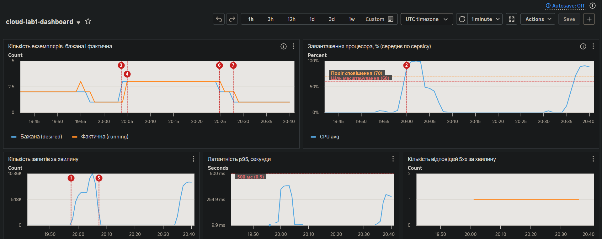
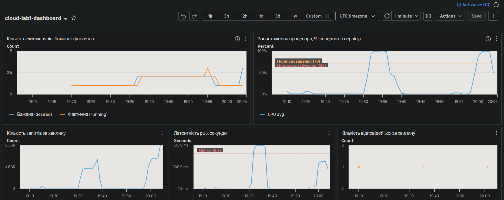
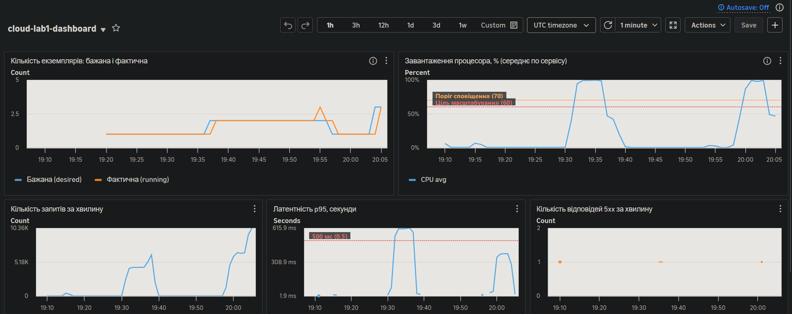
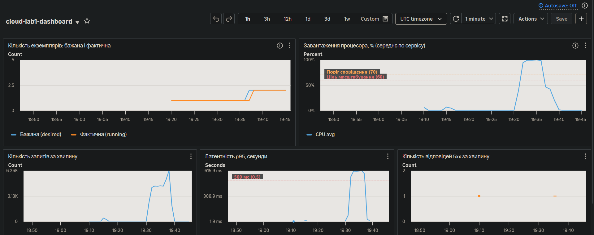

# Автоматичне масштабування і панель моніторингу

Код: [`terraform/autoscaling.tf`](../terraform/autoscaling.tf), [`terraform/monitoring.tf`](../terraform/monitoring.tf), блок `lifecycle` у [`terraform/app.tf`](../terraform/app.tf).

## 1. Параметри політики

Масштабується ECS-сервіс `cloud-lab1-service` (Fargate, 0,25 vCPU / 0,5 ГБ на екземпляр).

| Параметр | Значення | Де задано |
|---|---|---|
| Мінімум екземплярів | 1 | `var.autoscaling_min` |
| Максимум екземплярів | 4 | `var.autoscaling_max` |
| Основна політика | target tracking за `ECSServiceAverageCPUUtilization` | `aws_appautoscaling_policy.cpu` |
| Цільове значення | 60 % | `var.autoscaling_cpu_target` |
| Cooldown після додавання | 60 с | `scale_out_cooldown` |
| Cooldown після вилучення | 120 с | `scale_in_cooldown` |
| Швидка політика | step scaling: CPU > 70 % протягом 1 хв → +2 екземпляри, cooldown 120 с | `aws_appautoscaling_policy.cpu_spike` |

### Чому метрика — процесор

Сервіс обмежений саме процесором: під навантаженням один екземпляр упирається в 100 % CPU, а база при цьому завантажена на 15–23 %. Для сервісу, який здебільшого чекає на базу, процесор був би поганим показником, і тоді варто було б брати кількість запитів на екземпляр (`ALBRequestCountPerTarget`) або латентність.

### Чому 60 %

- Від перетину порогу до появи нового екземпляра минає близько 5 хвилин (виміряно нижче). Увесь цей час навантаження несе наявний екземпляр, тому йому потрібен запас. При цілі 60 % лишається 40 % на зростання.
- Ціль 80–90 % запасу не дає: латентність зростає ще до того, як масштабування встигне відреагувати.
- Ціль 30–40 % тримала б зайві екземпляри, за які треба платити.

### Навіщо друга, швидка політика

Target tracking в ECS додає екземпляри лише після трьох хвилинних точок поспіль вище цілі. У першому прогоні з однією цією політикою новий екземпляр був замовлений лише наприкінці п'ятихвилинної сталої фази і запрацював уже під час спаду. Step-політика спрацьовує вже після однієї точки вище 70 % і додає одразу два екземпляри. Вилученням займається тільки target tracking.

### `ignore_changes = [desired_count]`

Без цього рядка в `aws_ecs_service.app` кожен `terraform apply` повертав би кількість екземплярів до 1, навіть якщо масштабування щойно підняло її до 3.

## 2. Період стабілізації (cooldown)

Cooldown — це пауза після дії масштабування, протягом якої політика не робить наступної дії того самого напряму. Вона потрібна, бо ефект дії видно не одразу: новий екземпляр має запуститися, пройти перевірку стану в балансувальнику і взяти на себе частину запитів, а метрика має це відобразити.

**Якщо cooldown дорівнює нулю:**

- Після додавання екземпляра метрика ще кілька хвилин показує старе, високе значення. Політика бачить, що проблема «не зникла», і додає ще й ще. У результаті екземплярів більше, ніж потрібно (перерегулювання).
- Після вилучення навантаження на решту зростає, політика одразу додає екземпляр назад, потім знову вилучає. Кількість екземплярів коливається (flapping).
- Кожен запуск коштує грошей і часу, а кожне вилучення обриває з'єднання. Сервіс стає менш стабільним, а не більш.

## 3. Панель моніторингу

Панель `cloud-lab1-dashboard` (CloudWatch), п'ять графіків:

| Графік | Метрика | Простір імен |
|---|---|---|
| Кількість екземплярів: бажана і фактична | `DesiredTaskCount`, `RunningTaskCount` | `ECS/ContainerInsights` |
| Завантаження процесора | `CPUUtilization`, середнє по сервісу | `AWS/ECS` |
| Кількість запитів за хвилину | `RequestCount`, сума | `AWS/ApplicationELB` |
| Латентність p95 | `TargetResponseTime`, статистика p95 | `AWS/ApplicationELB` |
| Кількість відповідей 5xx | `HTTPCode_Target_5XX_Count`, `HTTPCode_ELB_5XX_Count` | `AWS/ApplicationELB` |

Для перших двох метрик у кластері ввімкнено Container Insights (`setting` у `aws_ecs_cluster.main`).

### Прогін сценарію: уся історія

Сценарій із [`LOADTEST.md`](LOADTEST.md): 60 користувачів, 3 хв наростання, 5 хв сталого навантаження, 2 хв спаду. Час на графіках — UTC, 11.11.2026.

| № | Подія | Час (UTC) | Від початку тесту |
|---|---|---|---|
| 1 | Початок навантаження | 19:57:35 | 0 |
| 2 | Процесор вище цілі 60 % і порогу 70 % (точка за 20:00 — 86,7 %) | 20:00 | ≈ 2,5 хв |
| — | Початок сталої фази | 20:00:35 | 3 хв |
| 3 | Бажана кількість 1 → 3 (швидка політика) | 20:03:44 | 6 хв 09 с |
| 4 | Фактична кількість = 3, нові екземпляри приймають запити | ≈ 20:05 | ≈ 7,5 хв |
| — | Кінець сталої фази | 20:05:35 | 8 хв |
| 5 | Кінець навантаження | 20:07:35 | 10 хв |
| 6 | Вилучення: бажана кількість 3 → 2 | 20:24:58 | 27 хв 23 с |
| 7 | Вилучення: бажана кількість 2 → 1 | 20:27:58 | 30 хв 23 с |

Час початку взято з першого рядка звіту [`nocache.txt`](../loadtest/results/nocache.txt), час подій 3, 6, 7 — з журналу `aws application-autoscaling describe-scaling-activities`.

Нові екземпляри замовлено посередині сталої фази, через 3 хвилини після її початку, а приймати запити вони почали приблизно за пів хвилини до її кінця. Після цього процесор упав зі 100 % до ≈ 50 %, а кількість оброблених запитів зросла з ≈ 6 до ≈ 10 тисяч за хвилину.

Проміжні знімки того самого прогону:

| 20:06 UTC: бажана кількість уже 3, екземпляри запускаються | 20:08 UTC: працюють три екземпляри, процесор упав |
|---|---|
|  |  |

Для порівняння — перший прогін, ще без швидкої політики (50 користувачів, наростання 2 хв). Екземпляр додано лише наприкінці сталої фази, і процесор увесь тест був на 100 %:

### Чому між перетином порогу і появою екземпляра минає час

Від першої точки вище порогу (20:00) до працюючих екземплярів (≈ 20:05) минуло близько 5 хвилин. Складові:

1. **Агрегація метрики.** CloudWatch рахує середнє за хвилину, тому точка з'являється лише після закінчення цієї хвилини.
2. **Затримка публікації.** Метрики ECS доходять до CloudWatch із запізненням. У листі сповіщення видно, що точки за 20:00 і 20:01 були оцінені лише о 20:04:39, тобто через ≈ 2,5 хв після кінця другої хвилини.
3. **Кількість точок.** Швидкій політиці потрібна одна точка вище порогу, target tracking — три поспіль. Це захист від реакції на короткий сплеск.
4. **Запуск екземпляра.** Fargate має виділити ресурси, завантажити образ з ECR, запустити контейнер; застосунок чекає на базу.
5. **Перевірка стану.** Балансувальник починає слати запити лише після двох успішних перевірок `/health` з інтервалом 15 с.

### Чому вилучення відбувається значно пізніше за падіння навантаження

Навантаження закінчилось о 20:07:35, а перший екземпляр вилучено о 20:24:58, через 17 хвилин.

- Target tracking створює окрему тривогу на вилучення, яка спрацьовує лише після **15 хвилинних точок поспіль** нижче за ціль (із запасом: нижче 54 %). Це вбудована поведінка AWS.
- Асиметрія навмисна. Зайвий екземпляр коштує кілька центів, а передчасно вилучений означає перевантаження і повільні відповіді, поки запускається новий. Помилка в бік «забагато» дешевша.
- Вилучення йде поступово: між кроками 3 → 2 і 2 → 1 минуло 3 хвилини (`scale_in_cooldown` = 120 с плюс хвилина на оцінку метрики).
- Перед зупинкою екземпляр 30 секунд дообробляє поточні запити (`deregistration_delay` у `aws_lb_target_group.app`): балансувальник уже не шле йому нових, а контейнер отримує SIGTERM і завершує роботу коректно.
