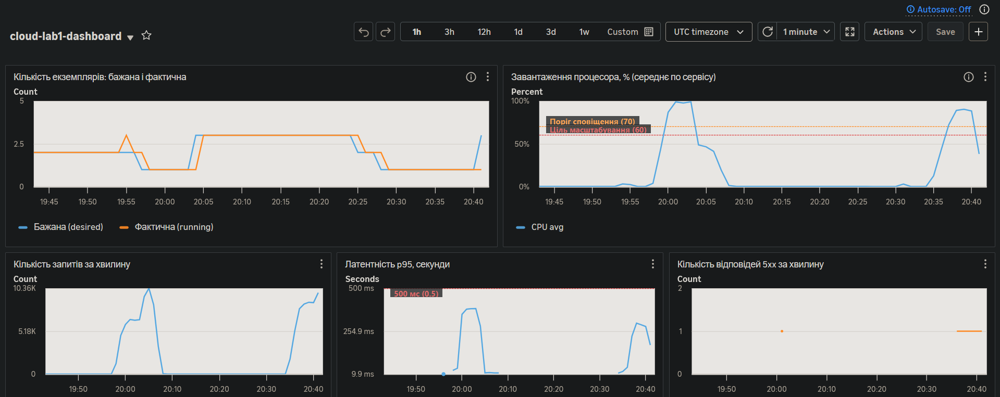

# Кешування операцій читання

Код: [`app/cache.py`](../app/cache.py), функції `list_devices` і `get_device` в [`app/main.py`](../app/main.py), Redis у [`terraform/redis.tf`](../terraform/redis.tf).

## Що зроблено

Дві найчастіші операції читання переведено на схему **cache-aside**:

- `GET /devices` — список пристроїв, ключ `devices:all`;
- `GET /devices/{id}` — один пристрій, ключ `device:{id}`.

Разом це 6 із 10 запитів сценарію навантаження.

Алгоритм (на прикладі `list_devices`):

1. Сервіс питає Redis за ключем.
2. Якщо запис є і його термін дії не сплив, сервіс повертає його. До бази звернення немає. Заголовок відповіді `X-Cache: HIT`.
3. Якщо запису немає, сервіс читає з бази, кладе результат у Redis із терміном дії **30 секунд** (`CACHE_TTL_SECONDS`) і повертає його. Заголовок `X-Cache: MISS`.

Кеш вмикається змінною `CACHE_ENABLED` (Terraform: `var.cache_enabled`). Статистику показує `GET /cache/stats`.

Якщо Redis недоступний, функції кешу перехоплюють помилку і повертають «немає в кеші»: сервіс працює далі й читає з бази. Тайм-аут на з'єднання з Redis — 0,5 с.

## Де працює Redis

Образ `redis:7-alpine` запущено **окремим ECS-сервісом** `cloud-lab1-redis`, одним екземпляром. Екземпляри API знаходять його за іменем `redis.cloud-lab1.internal` (AWS Cloud Map, приватна DNS-зона у VPC). Security group Redis приймає з'єднання на порт 6379 лише від security group застосунку.

Керований ElastiCache не використано через вартість (≈ $12–16 на місяць, поза безкоштовним рівнем).

### Чому не кеш у пам'яті процесу

Сервіс масштабується до чотирьох екземплярів. Якби кожен мав власний кеш у пам'яті:

- **Різні відповіді на той самий запит.** Балансувальник розподіляє запити між екземплярами, і клієнт бачив би то нові дані, то старі, залежно від того, на який екземпляр потрапив.
- **Інвалідація не працює.** Запис потрапляє на один екземпляр, і лише він очистить свій кеш. Решта віддаватимуть застарілі дані до кінця TTL.
- **Холодний кеш після масштабування.** Кожен новий екземпляр стартує з порожнім кешем саме в момент пікового навантаження.
- **Нижча частка влучань.** Кожен екземпляр окремо ходить у базу по ті самі дані.

Спільний Redis розв'язує всі чотири проблеми: кеш один, усі екземпляри читають і очищають ті самі ключі.

## Порівняння: без кешу і з кешем

Той самий сценарій (60 користувачів, 10 хв), той самий образ, ті самі налаштування масштабування. Відрізняється лише `CACHE_ENABLED`. Сирі звіти: [`nocache.txt`](../loadtest/results/nocache.txt), [`cache.txt`](../loadtest/results/cache.txt).

| Показник | Без кешу | З кешем | Зміна |
|---|---|---|---|
| Латентність p95, усі запити | 389,6 мс | 276,7 мс | −29 % |
| Латентність p95, `GET /devices` | 382,4 мс | 199,3 мс | −48 % |
| Латентність p95, `GET /devices/{id}` | 324,4 мс | 197,0 мс | −39 % |
| Латентність p99, усі запити | 487,7 мс | 397,7 мс | −18 % |
| Запитів за секунду | 104,7 | 117,6 | +12 % |
| Усього запитів за 10 хв | 63 031 | 70 991 | +12 % |
| Навантаження на базу: CPU RDS, середнє за сталу фазу | 18,7 % | 13,6 % | −27 % |
| Навантаження на базу: CPU RDS, пік | 23,3 % | 16,6 % | −29 % |

Навантаження на базу знизилось на 27 %, хоча сервіс обробив на 12 % більше запитів. Операції, які не кешуються (`POST` і читання показників), теж прискорились на 16–17 % за p95: процесор екземплярів менше зайнятий, і черга запитів коротша.

Панель моніторингу під час прогону з кешем (правий сплеск на графіках; лівий — прогін без кешу):

## Частка влучань у кеш

| Джерело | Влучань | Промахів | Частка влучань |
|---|---|---|---|
| k6, за заголовком `X-Cache` | 42 128 | 464 | **98,91 %** |
| Redis, лічильники `keyspace_hits` / `keyspace_misses` | 42 130 | 465 | 98,91 % |

Частка висока, бо під час тесту пристрої не змінюються: записуються лише показники, а вони не кешуються. Промахи — це перше звернення до кожного з 21 ключа і повторне після кожного спливання TTL: 21 ключ × ≈ 20 півхвилинних інтервалів ≈ 420, решта — одночасні промахи кількох запитів.

## Скільки часу клієнт може бачити застарілі дані

**Без додаткових заходів — до 30 секунд**, тобто до кінця TTL.

У сервісі цей час скорочено **інвалідацією при записі**: `POST /devices`, `PATCH /devices/{id}` і `DELETE /devices/{id}` після `commit` у базу видаляють відповідні ключі (`cache.invalidate(...)`). Наступне читання дає промах і бере свіжі дані з бази. Оскільки Redis спільний, це діє для всіх екземплярів одразу.

Застарілі дані все ще можливі в трьох випадках, і тоді вони живуть до 30 с:

1. **Гонка читання і запису.** Запит на читання взяв старі дані з бази, у цей момент інший запит змінив дані й очистив кеш, після чого перший поклав у кеш уже застаріле значення.
2. **Збій Redis у момент інвалідації.** Помилка перехоплюється, запис у базі змінено, а ключ у кеші залишився.
3. **Зміна даних в обхід сервісу**, наприклад напряму в базі.

### Як зменшити цей час

| Спосіб | Ціна |
|---|---|
| Зменшити TTL (наприклад, до 5 с) | більше промахів і більше запитів до бази |
| Інвалідація при записі (зроблено) | залишаються випадки 1–3 |
| Write-through: при записі одразу оновлювати значення в кеші | складніший код, запис повільніший |
| Версія або час зміни в ключі кешу | потрібне додаткове звернення по версію |

Вибір TTL — компроміс. TTL у 1 секунду майже не дає застарілих даних, але кеш майже не розвантажує базу. TTL в 1 годину розвантажує максимально, але без надійної інвалідації клієнт може годину бачити старе. 30 секунд обрано тому, що інформація про пристрій змінюється рідко, а короткочасна неточність для неї не критична.

Показники (`GET /devices/{id}/readings`) навмисно не кешуються: вони змінюються постійно, і клієнт очікує побачити щойно записане значення. Це підтверджує перевірка `new reading is visible` у сценарії — 100 % в обох прогонах.

## Лавинне звернення до бази (cache stampede)

Коли спливає TTL популярного ключа, кілька одночасних запитів отримують промах і всі разом ідуть у базу. У тесті це видно: промахів 464, а не ≈ 420. Для цього сервісу запит дешевий, тому захисту не додано. За потреби це розв'язується блокуванням на ключ (у базу йде один запит, решта чекають), випадковою добавкою до TTL або фоновим оновленням ключа до спливання терміну.
