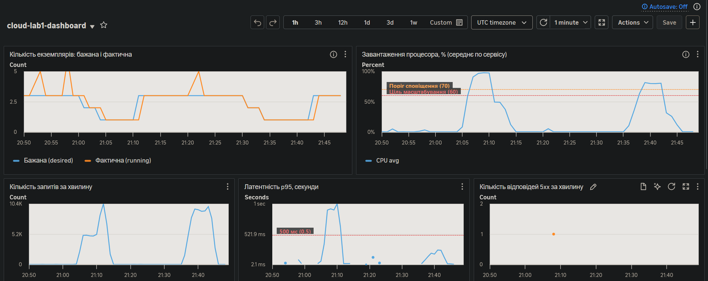
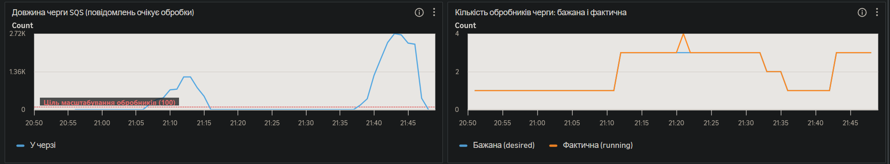
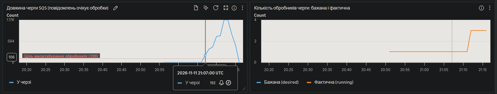

# Асинхронна обробка через чергу

Код: [`app/jobs.py`](../app/jobs.py) (відправка в чергу), [`app/worker.py`](../app/worker.py) (обробник), функції `add_reading`, `enqueue_reading`, `reading_request_status` в [`app/main.py`](../app/main.py), інфраструктура в [`terraform/queue.tf`](../terraform/queue.tf).

## Як це влаштовано

```text
клієнт ──POST──▶ API ──▶ черга SQS ──▶ обробник ──▶ база
          ◀─202──┘                        │
клієнт ──GET status_url──▶ API ◀─ Redis ◀─┘ (статус: queued → done)
```

- Режим вмикається змінною `ASYNC_WRITES` (Terraform: `var.async_writes`).
- `POST /devices/{id}/readings` перевіряє формат даних, кладе повідомлення в чергу `cloud-lab1-readings` і відповідає **`202 Accepted`**. До бази API не звертається.
- Обробник — окремий ECS-сервіс `cloud-lab1-worker`: той самий образ, але команда запуску `python -m app.worker`. Він читає чергу (long polling, до 10 повідомлень за раз), записує показник у базу і видаляє повідомлення.
- Обробка одного повідомлення штучно сповільнена на 150 мс (`WORKER_DELAY_MS`). Це імітація тривалої операції: без неї один обробник встигав би за будь-яким навантаженням цього тесту, і масштабування не було б видно.
- Права розділено ролями IAM: API може лише `sqs:SendMessage`, обробник — лише `ReceiveMessage`, `DeleteMessage`, `GetQueueAttributes`.
- Повідомлення, яке не вдалося обробити 5 разів, потрапляє в чергу `cloud-lab1-readings-dlq`.

### Масштабування обробника

Політика `aws_appautoscaling_policy.worker_queue`: target tracking за метрикою SQS `ApproximateNumberOfMessagesVisible`, ціль — 100 повідомлень у черзі, від 1 до 3 обробників.

## Що змінилося для клієнта

| | Прямий запис | Через чергу |
|---|---|---|
| Код відповіді | `201 Created` | `202 Accepted` |
| Тіло відповіді | створений показник з `id` | `request_id`, `status: "queued"`, `status_url` |
| Коли дані в базі | до відповіді | через деякий час після відповіді |
| Помилка «пристрою не існує» | одразу, `404` | пізніше, у статусі запиту: `failed` |
| Читання одразу після запису | показник уже видно | показника ще може не бути |

`201` означає «зроблено». `202` означає лише «прийнято в роботу»: сервіс обіцяє спробувати, але результату ще немає. Клієнт має бути готовий до того, що запис з'явиться пізніше або не з'явиться взагалі.

## Як клієнт дізнається результат

Відповідь `202` містить адресу для перевірки:

```json
{
  "request_id": "76da52bf-83d9-4460-9196-f8a65ff92591",
  "status": "queued",
  "status_url": "/readings/requests/76da52bf-83d9-4460-9196-f8a65ff92591"
}
```

Клієнт періодично опитує `GET /readings/requests/{request_id}`:

| Статус | Зміст |
|---|---|
| `queued` | запит у черзі або обробляється |
| `done` | записано; у відповіді є поле `reading` зі створеним показником |
| `failed` | не виконано; у відповіді є поле `error` |

Статус зберігається в Redis одну годину. Альтернативи опитуванню — webhook (сервіс сам викликає адресу клієнта) або постійне з'єднання (WebSocket, SSE). Опитування обрано як найпростіше.

## Доставка «щонайменше один раз»

SQS гарантує, що кожне повідомлення буде доставлено **щонайменше один раз**: воно не загубиться, але може прийти двічі.

Механізм такий. Коли обробник отримує повідомлення, воно не видаляється, а стає невидимим для інших на 60 секунд (`visibility_timeout_seconds`). Обробник видаляє його сам, і лише після успішного запису в базу. Якщо обробник упав або не встиг, повідомлення знову стає видимим і його отримує інший обробник.

Протилежна гарантія, «щонайбільше один раз», означала б видалення повідомлення одразу при отриманні: дублікатів немає, але збій обробника означає втрату даних. Черги зазвичай надають першу гарантію, бо дублікат можна розпізнати й відкинути, а втрачене повідомлення відновити нізвідки.

### Що буде при повторній обробці

Без захисту в базі з'явилися б два однакові показники. Тому обробник робить операцію ідемпотентною:

1. Перед обробкою перевіряє в Redis позначку `processed:{request_id}`. Якщо вона є, повідомлення пропускається і видаляється з черги.
2. Після `commit` у базу ставить цю позначку на 24 години.

Обмеження: перевірка і запис не атомарні. Якщо обробник упаде між `commit` і записом позначки, повторна доставка створить дублікат. Повністю надійний варіант — унікальний стовпець `request_id` у таблиці. Докладніше про зв'язок з ідемпотентністю API — в [`IDEMPOTENCY.md`](IDEMPOTENCY.md).

## Результати під навантаженням

Сценарій із [`LOADTEST.md`](LOADTEST.md): 60 користувачів, 10 хвилин, кеш увімкнено в усіх трьох прогонах.

| Показник | Прямий запис | Черга, версія 1 | Черга, версія 2 |
|---|---|---|---|
| Як API відправляє в SQS | — | окремий виклик на кожен запит | пачками до 10 з фонового потоку |
| p95, `POST /devices/{id}/readings` | 340,1 мс | 797,5 мс | **181,8 мс** |
| Медіана `POST` | 49,6 мс | 51,4 мс | 41,6 мс |
| p95, усі запити | 276,7 мс | 816,7 мс | **203,6 мс** |
| p99, усі запити | 397,7 мс | 1,10 с | 356,4 мс |
| Запитів за секунду | 117,6 | 91,0 | **120,0** |
| Помилок | 2 | 1 | 0 |
| Файл звіту | `cache.txt` | `queue-v1-sync-send.txt` | `queue.txt` |

### Перша версія погіршила латентність

У першій версії кожен `POST` робив окремий виклик `sqs.send_message`. Латентність не знизилась, а зросла більш ніж удвічі, і пропускна здатність одного екземпляра впала з ≈ 10 до ≈ 5 тисяч запитів за хвилину при тих самих 100 % процесора.

Найімовірніша причина: підписаний HTTPS-виклик до SQS через boto3 коштує процесору екземпляра (0,25 vCPU) більше, ніж простий `INSERT`, який він замінив. Тобто з обробки запиту винесли дешеву операцію, а натомість додали дорожчу. Окремим профілюванням це не перевірялося; висновок зроблено з того, що змінилася лише ця частина коду, а виправлення саме цієї частини повернуло показники.

### Друга версія: пакетна відправка

Тепер `POST` кладе повідомлення у внутрішній буфер і одразу відповідає `202`. Фоновий потік (`_sender_loop` у `app/jobs.py`) збирає до 10 повідомлень або чекає не довше 50 мс і відправляє їх одним викликом `SendMessageBatch`. Викликів до SQS стало приблизно вдесятеро менше.

Результат: p95 запису 182 мс проти 340 мс при прямому записі (−47 %), загальний p95 204 мс проти 277 мс (−26 %), жодної помилки.

**Ціна цього рішення.** Відповідь `202` тепер надходить до того, як повідомлення потрапило в SQS. Якщо екземпляр аварійно завершиться, повідомлення, які пролежали в буфері менше 50 мс, буде втрачено. При штатній зупинці (SIGTERM під час вилучення екземпляра чи розгортання) буфер відправляється повністю: це робить `jobs.shutdown()` у `lifespan`. Для показників датчиків, де втрата одиничного значення не критична, такий компроміс прийнятний. Для платежів він був би неприйнятним, і довелося б залишити відправку в межах запиту, заплативши латентністю або більшим екземпляром.

### Панель моніторингу

На кожному графіку лівий сплеск — версія 1, правий — версія 2. Час — UTC, 11.11.2026.



На графіку латентності p95 видно різницю: у версії 1 пік близько 1 секунди, у версії 2 — близько 200 мс, нижче за позначку 500 мс.



| Подія (версія 2) | Час (UTC) |
|---|---|
| Початок тесту | ≈ 21:38 |
| Черга перевищила ціль 100 | ≈ 21:39 |
| Бажана кількість обробників 1 → 3 | 21:42:16 |
| Пік черги, ≈ 2 700 повідомлень | ≈ 21:43 |
| Черга порожня | ≈ 21:48 |

Що тут видно:

- **Обробник масштабується від довжини черги.** Один обробник встигає 5–6 повідомлень за секунду, а надходить близько 12. Черга росте, перетинає ціль, і політика піднімає кількість обробників до трьох. Після цього черга перестає рости і спадає до нуля.
- **Латентність сервісу від цього не залежить.** Поки в черзі лежало 2 700 необроблених повідомлень, API відповідав на запис за 42 мс (медіана). Навантаження на запис поглинає черга, а не клієнт.
- **Вилучення обробників повільне**, як і в API. Після першого прогону черга спорожніла о ≈ 21:16, а обробників зменшено о 21:32:38 (3 → 2) і 21:35:38 (2 → 1), тобто через 16–19 хвилин.

Журнал масштабування обробника (`describe-scaling-activities`, київський час):

```text
2026-11-11T23:11:16  Setting desired count to 3.   <- версія 1
2026-11-11T23:32:38  Setting desired count to 2.
2026-11-11T23:35:38  Setting desired count to 1.
2026-11-11T23:42:16  Setting desired count to 3.   <- версія 2
```

Перша версія окремо:


